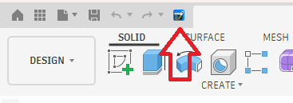
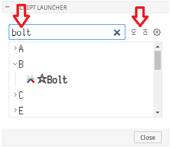
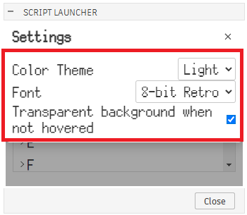
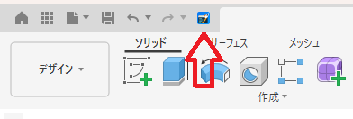
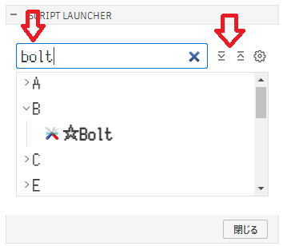
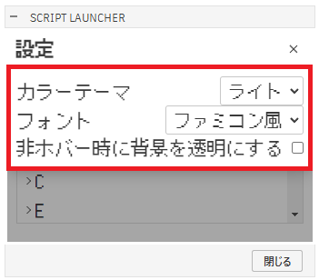

# ***Autodesk Fusion ScriptLauncher***
This is an add-in for Autodesk Fusion.

A tree-like menu to simplify the sequential execution of scripts.

---

## **Installation**:

1. Quit Autodesk Fusion.
2. Download and extract the zip file.
3. Run `installer\install_Win.cmd` in the extracted folder.
4. Follow the on-screen instructions and enter `Y`.
5. The "ScriptLauncher" folder is copied to `%APPDATA%\Autodesk\Autodesk Fusion 360\API\AddIns\ScriptLauncher`.

To uninstall, delete the copied "ScriptLauncher" folder.

---
## **usage method**:

- After launching the add-in, the "Script Launcher" command will be added to the Quick Access Toolbar (QAT).

- After executing the command, a palette will appear, displaying a menu divided into a tree with numbers, each letter of the alphabet, and others.

  - Scripts marked with ☆ are installed by default.

- The scripts that will be registered in the menu are all the scripts listed in the "Scripts" tab of the "Scripts and Add-Ins" menu.

- Double-clicking on any script executes the corresponding script.

- Right-clicking on a script and selecting "Open Folder" opens the folder of that script.

---

## **Features**:

- **Supported workspaces**
  - The command is added to the Quick Access Toolbar (QAT), so it can be used in any workspace.
  - In the "Render" workspace, an "Add-Ins" panel is prepared in the "Utilities" tab (each is created if it does not exist), and this command, "Scripts and Add-Ins" and "Fusion App Store" are added to it.

- **Tree grouping rules**
  - Scripts are grouped by the first character of their name (case-insensitive).
    - Names starting with a digit → "Number"
    - Names starting with A-Z → the group for that letter
    - Anything else (e.g. Japanese names or symbols) → "other"
  - Scripts within a group are sorted alphabetically.
  - Groups with no scripts are not shown.

- **Display**
  - If iconFilename is specified in the script's manifest, the script is shown with that icon (limited to image files of 1MB or less inside the script folder).
  - Otherwise, Python scripts and C++ scripts are shown with their own icons.
  - The palette text switches to match Fusion's display language.
  - Hovering the mouse cursor over a script shows its description as a tooltip.
  - The ☆ mark is added to the sample scripts bundled with Autodesk Fusion (those in the same folder as "SpurGear").

- **Not shown**
  - Add-ins
  - Scripts set to hidden

- **Refreshing the list**
  - The script list is loaded when the command is executed and the palette opens.
  - If you add or remove scripts while the palette is open, run the command again to get the latest list.

- **Search / Toolbar**
  - You can search for scripts with the search box at the top of the tree.
    - The search targets are the "script name" and the "description". A script matches if either of them hits.
    - Partial match, case-insensitive.
    - Wildcards can be used (`*`: any string, `?`: any single character).
    - Matching scripts are shown in bold, and only the groups containing matches are expanded.
    - Pressing the Esc key in the search box clears the search.
  - The buttons to the right of the search box provide "Expand All", "Collapse All" and "Settings".

- **Settings**
  - The "Settings" button on the toolbar opens the settings panel.
    - Color Theme (Light / Dark)
    - Font (8-bit Retro / Standard)
    - Transparent background when not hovered (On / Off)
  - Settings are saved to setting.json in the ScriptLauncher folder and restored the next time the palette is shown.
  - When the palette is floating, its size (width and height) at the time it is closed is also saved and restored the next time it is shown.

- **Keyboard operation**
  - ↑ / ↓ : Move to the previous / next item
  - → : Expand a group, or move to its first script if already expanded
  - ← : Collapse a group, or move to the group
  - Home / End : Move to the first / last item

---

## **Environment**:

The following environment is confirmed.

- Autodesk Fusion Ver2706.1.17
- Windows11 64bit Home

---

## **License**:
- Apache License 2.0

---

## **Acknowledgments**:

- [PixelMplus](http://itouhiro.hatenablog.com/entry/20130602/font) (PixelMplus12-Regular) is used as the 8-bit retro font. Many thanks to Itou Hiroki and the M+ FONTS PROJECT for publishing such a wonderful font.
  - License: M+ FONT LICENSE

---
---

# *** 以下は日本語です。***

このアドインは、Autodesk Fusion用アドインです。

スクリプトの連続実行を簡素化する為のツリー状のメニューです。

---

## **インストール**:
1. Fusion を終了します。
2. zip ファイルをダウンロードし、展開します。
3. 展開したフォルダ内の `installer\install_Win.cmd` を実行します。
4. 画面の指示に従い、`Y` を入力します。
5. "ScriptLauncher" フォルダが `%APPDATA%\Autodesk\Autodesk Fusion 360\API\AddIns\ScriptLauncher` にコピーされます。

アンインストールはコピーされた "ScriptLauncher" フォルダを削除してください。

---
## **使用法**:

- アドイン起動後は、クイックアクセスツールバー（QAT）に "Script Launcher" コマンドが追加されます。

- コマンド実行後はパレットが表示され、数字・各アルファベット・その他でツリー分けされたメニューが表示されます。

  - ☆印はデフォルトでインストールされているスクリプトです。

- メニューに登録されるスクリプトは、"スクリプトとアドイン"の"スクリプト"タブで表示されている全てのスクリプトです。

- 任意のスクリプトをダブルクリックする事で、該当するスクリプトが実行されます。

- スクリプトを右クリックして "フォルダオープン" を選ぶと、該当するスクリプトのフォルダが開きます。

---

## **機能**:

- **対応ワークスペース**
  - コマンドはクイックアクセスツールバー（QAT）に追加されるため、ワークスペースを問わず使用できます。
  - "レンダリング" では、"ユーティリティ" タブ（無い場合は作成）に "アドイン" パネル（無い場合は作成）を用意し、本コマンドと "スクリプトとアドイン"・"Fusion App Store" を登録します。

- **ツリーの分類ルール**
  - スクリプト名の先頭文字でグループ分けします（大文字・小文字は区別しません）。
    - 数字で始まるもの → "Number"
    - A～Z で始まるもの → 各アルファベットのグループ
    - それ以外（日本語名・記号など）→ "other"
  - グループ内は名前のアルファベット順に並びます。
  - スクリプトが1つもないグループは表示されません。

- **表示内容**
  - スクリプトの manifest に iconFilename が指定されている場合は、そのアイコンで表示されます（スクリプトフォルダ内にある、1MB 以下の画像ファイルに限ります）。
  - 指定が無い場合、Python スクリプトと C++ スクリプトは、それぞれ専用のアイコンで表示されます。
  - パレットの文言は、Fusion の表示言語に合わせて切り替わります。
  - スクリプトにマウスカーソルを合わせると、スクリプトの説明（description）がツールチップで表示されます。
  - ☆印は、Autodesk Fusion に標準で入っているサンプルスクリプト（"SpurGear" と同じフォルダにあるもの）に付きます。

- **表示されないもの**
  - アドイン
  - 非表示に設定されているスクリプト

- **一覧の更新**
  - スクリプトの一覧は、コマンドを実行してパレットを開いたときに読み込まれます。
  - パレットを開いている間にスクリプトを追加・削除した場合は、もう一度コマンドを実行すると最新の一覧になります。

- **検索・ツールバー**
  - ツリー上部の検索ボックスで、スクリプトを検索できます。
    - 検索対象は "スクリプト名" と "説明（description）" です。どちらかにヒットすれば該当します。
    - 部分一致で、大文字・小文字は区別しません。
    - ワイルドカード（`*`: 任意の文字列、`?`: 任意の1文字）が使えます。
    - ヒットしたスクリプトは太字で表示され、ヒットを含むグループのみ展開されます。
    - 検索ボックスで Esc キーを押すと検索をクリアします。
  - 検索ボックスの右のボタンで、"すべて展開"・"すべて折りたたみ"・"設定" を行えます。

- **設定**
  - ツールバーの "設定" ボタンで設定パネルが開きます。
    - カラーテーマ（ライト／ダーク）
    - フォント（ファミコン風／標準）
    - 非ホバー時に背景を透明にする（オン／オフ）
  - 設定は ScriptLauncher フォルダ内の setting.json に保存され、次回表示時に復元されます。
  - パレットがフローティング状態のときは、閉じた時点のサイズ（幅・高さ）も保存され、次回表示時に復元されます。

- **キーボード操作**
  - ↑ / ↓ : 前 / 次の項目へ移動
  - → : グループを展開、展開済みなら最初のスクリプトへ移動
  - ← : グループを折りたたみ、またはグループへ移動
  - Home / End : 先頭 / 末尾の項目へ移動

---

## **動作環境**:
- Autodesk Fusion Ver2706.1.17

- Windows11 64bit Home

---

## **ライセンス**:
- Apache License 2.0

---

## **謝辞** :

- [日本語フォーラム](https://forums.autodesk.com/t5/fusion-360-ri-ben-yu/bd-p/707)の皆さん、ありがとう。

- ファミコン風フォントとして [PixelMplus](http://itouhiro.hatenablog.com/entry/20130602/font)（PixelMplus12-Regular）を使用させていただきました。素敵なフォントを公開してくださった Itou Hiroki 様、M+ FONTS PROJECT の皆様に感謝いたします。
  - ライセンス: M+ FONT LICENSE
