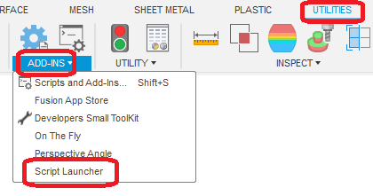
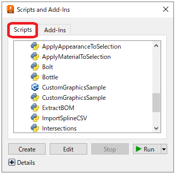
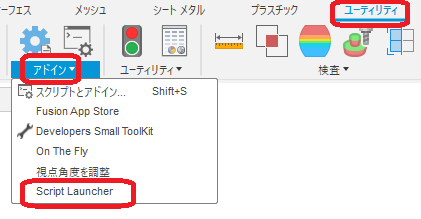
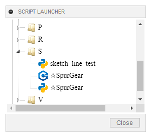
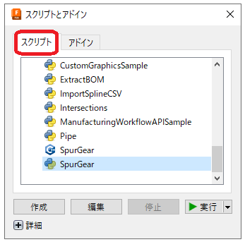

# ***Autodesk Fusion ScriptLauncher***
This is an add-in for the Autodesk software Fusion360.

A tree-like menu to simplify the sequential execution of scripts.

---

## **Installation**:

To install, download/extract the zip file and register the "ScriptLauncher" folder as an **add-in**.

To register add-ins, follow the instructions [here](https://knowledge.autodesk.com/support/fusion-360/troubleshooting/caas/sfdcarticles/sfdcarticles/How-to-install-an-ADD-IN-and-Script-in-Fusion-360.html).

---
## **usage method**:

- After launching the add-in, the "Script Launcher" command will be added in "Utilities" - "Add-Ins".

- After executing the command, a dialog box will appear, displaying a menu divided into a tree with numbers, each letter of the alphabet, and others.

  - Scripts marked with ☆ are installed by default.

- The scripts that will be registered in the menu are all the scripts listed in the "Scripts" tab of the "Scripts and Add-Ins" menu.

- Double-clicking on any script executes the corresponding script.

---

## **Features**:

- **Supported workspaces**
  - The command is added to the "Utilities" - "Add-Ins" panel in both the "Design" and "Manufacture (CAM)" workspaces.

- **Tree grouping rules**
  - Scripts are grouped by the first character of their name (case-insensitive).
    - Names starting with a digit → "Number"
    - Names starting with A-Z → the group for that letter
    - Anything else (e.g. Japanese names or symbols) → "other"
  - Scripts within a group are sorted alphabetically.
  - Groups with no scripts are not shown.

- **Display**
  - Python scripts and C++ scripts are shown with their own icons.
  - Hovering the mouse cursor over a script shows its description as a tooltip.
  - The ☆ mark is added to the sample scripts bundled with Fusion360 (those in the same folder as "SpurGear").

- **Not shown**
  - Add-ins
  - Scripts set to hidden

- **Refreshing the list**
  - The script list is loaded when the command is executed and the palette opens.
  - If you add or remove scripts while the palette is open, run the command again to get the latest list.

---

## **Libraries**:
- [jsTree](https://www.jstree.com/) (MIT License)
- [jQuery](https://jquery.com/) (MIT License)

---

## **Environment**:

The following environment is confirmed.

- Fusion360 Ver2.0.18719
- Windows10 64bit Home

---

## **License**:
- Apache License 2.0

---
---

# *** 以下は日本語です。***

このアドインは、Fusion360用アドインです。

スクリプトの連続実行を簡素化する為のツリー状のメニューです。

---

## **インストール**:
インストールする際は、zip ファイルをダウンロード/展開後 "ScriptLauncher" フォルダを **アドイン** として登録してください。

アドインの登録は、[こちら](https://kantoku.hatenablog.com/entry/2021/02/15/161734)の手順に従ってください。

---
## **使用法**:

- アドイン起動後は、"ユーティリティ" - "アドイン" 内に "Script Launcher" コマンドが追加されます。

- コマンド実行後はダイアログが表示され、数字・各アルファベット・その他でツリー分けされたメニューが表示されます。

  - ☆印はデフォルトでインストールされているスクリプトです。

- メニューに登録されるスクリプトは、"スクリプトとアドイン"の"スクリプト"タブで表示されている全てのスクリプトです。

- 任意のスクリプトをダブルクリックする事で、該当するスクリプトが実行されます。

---

## **機能**:

- **対応ワークスペース**
  - "デザイン" と "製造(CAM)" の両方の "ユーティリティ" - "アドイン" パネルにコマンドが追加されます。

- **ツリーの分類ルール**
  - スクリプト名の先頭文字でグループ分けします（大文字・小文字は区別しません）。
    - 数字で始まるもの → "Number"
    - A～Z で始まるもの → 各アルファベットのグループ
    - それ以外（日本語名・記号など）→ "other"
  - グループ内は名前のアルファベット順に並びます。
  - スクリプトが1つもないグループは表示されません。

- **表示内容**
  - Python スクリプトと C++ スクリプトは、それぞれ専用のアイコンで表示されます。
  - スクリプトにマウスカーソルを合わせると、スクリプトの説明（description）がツールチップで表示されます。
  - ☆印は、Fusion360 に標準で入っているサンプルスクリプト（"SpurGear" と同じフォルダにあるもの）に付きます。

- **表示されないもの**
  - アドイン
  - 非表示に設定されているスクリプト

- **一覧の更新**
  - スクリプトの一覧は、コマンドを実行してパレットを開いたときに読み込まれます。
  - パレットを開いている間にスクリプトを追加・削除した場合は、もう一度コマンドを実行すると最新の一覧になります。

---

## **使用ライブラリ**:
- [jsTree](https://www.jstree.com/) (MIT License)
- [jQuery](https://jquery.com/) (MIT License)

---

## **動作環境**:
- Autodesk Fusion Ver2706.1.14

- Windows10 64bit Home

---

## **ライセンス**:
- Apache License 2.0

---

## **謝辞** :

- [日本語フォーラム](https://forums.autodesk.com/t5/fusion-360-ri-ben-yu/bd-p/707)の皆さん、ありがとう。
